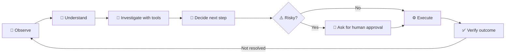
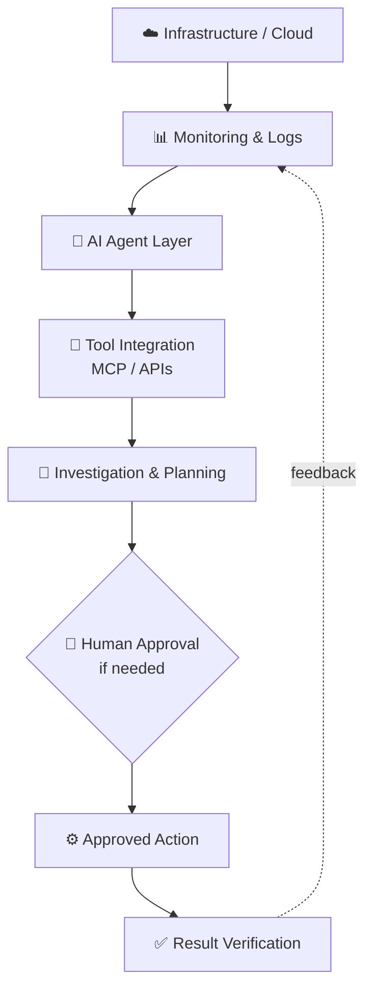
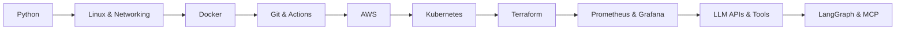

<div align="center">

# 🚀 Agentic AI + DevOps Projects

### 10 real-world, portfolio-worthy projects for 2027

Build AI agents that **observe** systems, **investigate** problems, **use tools**, **recommend actions**, and **verify results**.


[Projects](#-the-10-projects) • [Architecture](#%EF%B8%8F-reference-architecture) • [Safety](#-safety-first) • [Learning Path](#-learning-path) • [Contribute](#-contributing)

</div>

---

## 📖 Table of Contents

- [Why This Repo](#-why-this-repo)
- [What Makes a Project "Agentic"](#-what-makes-a-project-agentic)
- [Projects at a Glance](#-projects-at-a-glance)
- [The 10 Projects](#-the-10-projects)
- [Reference Architecture](#%EF%B8%8F-reference-architecture)
- [Safety First](#-safety-first)
- [Learning Path](#-learning-path)
- [Where to Start](#-where-to-start)
- [Suggested Repo Structure](#-suggested-repo-structure)
- [How to Make It Portfolio-Ready](#-how-to-make-it-portfolio-ready)
- [Learning Resources](#-learning-resources)
- [Contributing](#-contributing)

---

## 💡 Why This Repo

Most AI projects stop at a chatbot. Real engineering teams need more: systems that can **look at production**, **reason about what they see**, and **safely help humans act**.

Each project here is designed to:

- 🔍 Solve a **real problem** DevOps/SRE/Platform teams face every day
- 🧰 Use **real tools** (Prometheus, Kubernetes, Terraform, GitHub Actions, AWS…)
- 🛡️ Keep **humans in control** with read-only defaults and approval gates
- 📦 Be **demo-able**, so you can show it in a portfolio or interview

---

## 🧠 What Makes a Project "Agentic"?

A traditional automation script follows fixed instructions. An **agentic system** runs a loop:



| Step | What the agent does |
|---|---|
| **Observe** | Reads metrics, logs, events, pipeline output |
| **Understand** | Interprets the situation and forms hypotheses |
| **Investigate** | Calls tools and APIs to gather evidence |
| **Decide** | Chooses the most appropriate next step |
| **Approve** | Requests human sign-off for risky actions |
| **Act** | Executes only permitted actions |
| **Verify** | Confirms the issue is actually resolved |

> **Key idea:** the value is not in the LLM alone, it's in the **loop**, the **tools**, and the **guardrails** around it.

---

## 📊 Projects at a Glance

| # | Project | Difficulty | Core Stack | Domain |
|:-:|---|:-:|---|---|
| 1 | [AI Incident Investigation Agent](#1--ai-incident-investigation-agent) | 🟡 Intermediate | LangGraph, Grafana, Loki | Observability |
| 2 | [Self-Healing Kubernetes Agent](#2--self-healing-kubernetes-agent) | 🔴 Advanced | Kubernetes, MCP, Prometheus | Reliability |
| 3 | [AI CI/CD Debugging Agent](#3--ai-cicd-debugging-agent) | 🟢 Beginner–Intermediate | GitHub Actions, Docker, OpenAI API | CI/CD |
| 4 | [Cloud Cost Optimization Agent](#4--cloud-cost-optimization-agent) | 🟡 Intermediate | AWS, Boto3, CloudWatch | FinOps |
| 5 | [Infrastructure Drift Detection Agent](#5--infrastructure-drift-detection-agent) | 🟡 Intermediate | Terraform, AWS | IaC |
| 6 | [AI Security Agent](#6--ai-security-agent) | 🟡 Intermediate | Trivy, Snyk, Docker | DevSecOps |
| 7 | [Intelligent Monitoring Agent](#7--intelligent-monitoring-agent) | 🟡 Intermediate | Prometheus, Grafana, Loki | Observability |
| 8 | [Multi-Agent DevOps Platform](#8--multi-agent-devops-platform) | 🔴 Advanced | LangGraph, MCP, Kubernetes | Platform |
| 9 | [Deployment Risk Assessment Agent](#9--deployment-risk-assessment-agent) | 🟡 Intermediate | Argo CD, GitHub Actions | GitOps |
| 10 | [AI Runbook Assistant](#10--ai-runbook-assistant) | 🟢 Beginner | RAG, pgvector, LangGraph | Knowledge |

---

## 📌 The 10 Projects

> Click any project to expand it. Each includes the problem it solves, key features, and a suggested first milestone.

<details>
<summary><b>1 · 🕵️ AI Incident Investigation Agent</b> &nbsp;·&nbsp; 🟡 Intermediate</summary>

<br>

**The problem:** During an outage, engineers waste precious minutes digging through thousands of log lines.

**The solution:** An agent that analyzes production logs, identifies likely root causes, and suggests troubleshooting steps.

**Tech Stack:** `Python` `LangGraph` `Grafana` `Loki`

**Key Features**
- 📥 Collect and analyze application logs
- 📈 Detect unusual error patterns
- 🎯 Identify possible root causes
- 📝 Generate incident summaries
- 💡 Recommend solutions

**🏁 First milestone:** Feed sample logs from a demo app into Loki and have the agent produce a timeline plus top-3 root-cause hypotheses.

**⭐ Stretch goals:** Correlate with recent deployments · confidence scoring per hypothesis · post-mortem draft generation.

</details>

<details>
<summary><b>2 · ♻️ Self-Healing Kubernetes Agent</b> &nbsp;·&nbsp; 🔴 Advanced</summary>

<br>

**The problem:** Pods crash, deployments stall, and on-call engineers get paged for issues that follow known patterns.

**The solution:** An agent that monitors workloads, detects failures, and recommends (or performs, with approval) recovery actions.

**Tech Stack:** `Kubernetes` `Python` `MCP` `Prometheus`

**Key Features**
- ❤️ Monitor pod health
- 💥 Detect `CrashLoopBackOff` and failed deployments
- 🔬 Investigate resource issues (OOMKilled, CPU throttling, bad config)
- 🛠️ Recommend recovery actions
- ✅ Verify workload health after recovery

**🏁 First milestone:** On a local `kind`/`minikube` cluster, deliberately break a deployment and have the agent diagnose it in **read-only** mode.

**⭐ Stretch goals:** Approval flow via Slack · automatic rollback proposal · post-action health verification report.

</details>

<details>
<summary><b>3 · 🧪 AI CI/CD Debugging Agent</b> &nbsp;·&nbsp; 🟢 Beginner–Intermediate</summary>

<br>

**The problem:** Failed pipelines produce walls of logs that few people read carefully.

**The solution:** An agent that investigates failed CI/CD runs and explains *why* a build or deployment failed.

**Tech Stack:** `GitHub Actions` `Docker` `Python` `OpenAI API`

**Key Features**
- 📄 Read pipeline logs
- ❌ Identify failed steps
- 🧾 Explain build errors in plain language
- 🔧 Suggest fixes
- 📊 Generate debugging reports

**🏁 First milestone:** Trigger on a failed workflow run, fetch logs via the GitHub API, and post a summary comment on the pull request.

**⭐ Stretch goals:** Detect flaky tests · suggest a patch as a draft PR · track recurring failure categories.

</details>

<details>
<summary><b>4 · 💸 Cloud Cost Optimization Agent</b> &nbsp;·&nbsp; 🟡 Intermediate</summary>

<br>

**The problem:** Idle and oversized resources quietly inflate cloud bills.

**The solution:** An agent that analyzes usage and finds opportunities to cut unnecessary spend.

**Tech Stack:** `AWS` `Boto3` `CloudWatch` `Python`

**Key Features**
- 😴 Identify idle resources
- 📉 Analyze cloud usage
- 🚨 Detect cost spikes
- 💡 Recommend optimization strategies
- 📑 Generate cost reports

**🏁 First milestone:** Scan EC2/EBS/Elastic IPs for idle resources using read-only IAM and output a ranked savings report.

**⭐ Stretch goals:** Rightsizing suggestions from CloudWatch metrics · weekly report to Slack · cost-anomaly explanations.

</details>

<details>
<summary><b>5 · 🧬 Infrastructure Drift Detection Agent</b> &nbsp;·&nbsp; 🟡 Intermediate</summary>

<br>

**The problem:** Manual console changes cause real infrastructure to diverge from what Terraform says it should be.

**The solution:** An agent that detects and explains differences between declared and actual infrastructure.

**Tech Stack:** `Terraform` `AWS` `Python`

**Key Features**
- 📂 Analyze Terraform configurations
- 🔄 Detect infrastructure changes
- ⚖️ Identify configuration mismatches
- 📋 Generate drift reports
- 🧭 Recommend corrective actions

**🏁 First milestone:** Parse `terraform plan` output, then have the agent classify each change as *expected*, *risky*, or *unknown*.

**⭐ Stretch goals:** Scheduled drift scans · suggest "import vs. revert" per resource · security-impact scoring.

</details>

<details>
<summary><b>6 · 🛡️ AI Security Agent</b> &nbsp;·&nbsp; 🟡 Intermediate</summary>

<br>

**The problem:** Scanners produce hundreds of findings; teams can't tell what actually matters.

**The solution:** An agent that scans infrastructure and dependencies, prioritizes findings, and suggests remediation.

**Tech Stack:** `Trivy` `Snyk` `Python` `Docker`

**Key Features**
- 🐳 Scan container images
- 📦 Detect vulnerable dependencies
- 🎯 Prioritize security findings
- 🩹 Recommend patches
- 📑 Generate security reports

**🏁 First milestone:** Run Trivy on a sample image, then have the agent group findings by fix availability and exploitability context.

**⭐ Stretch goals:** Auto-generate upgrade PRs · deduplicate across images · track remediation over time.

</details>

<details>
<summary><b>7 · 📡 Intelligent Monitoring Agent</b> &nbsp;·&nbsp; 🟡 Intermediate</summary>

<br>

**The problem:** Alert fatigue. Too many alerts, too little context.

**The solution:** An AI-powered monitor that detects anomalies and investigates alerts for you.

**Tech Stack:** `Prometheus` `Grafana` `Loki` `Python`

**Key Features**
- 📊 Monitor infrastructure metrics
- 🔍 Detect unusual behavior
- 🔗 Correlate alerts with logs
- 📝 Summarize incidents
- ➡️ Recommend next steps

**🏁 First milestone:** On an Alertmanager webhook, pull related metrics and logs, then send an enriched alert summary.

**⭐ Stretch goals:** Alert grouping and deduplication · "what changed?" analysis · noise-reduction metrics.

</details>

<details>
<summary><b>8 · 🤝 Multi-Agent DevOps Platform</b> &nbsp;·&nbsp; 🔴 Advanced</summary>

<br>

**The problem:** Real operations span monitoring, security, deployment, and infrastructure, and no single agent should do it all.

**The solution:** A platform where specialized agents collaborate under a central orchestrator.

**Tech Stack:** `LangGraph` `MCP` `Kubernetes` `Python`

**Key Features**
- 📡 Monitoring agent
- 🛡️ Security agent
- 🚢 Deployment agent
- 🏗️ Infrastructure agent
- 🧠 Central orchestration workflow

**🏁 First milestone:** Two agents (monitoring + deployment) with a router that hands an incident from one to the other.

**⭐ Stretch goals:** Shared memory/context · per-agent permission scopes · full audit trail of every tool call.

</details>

<details>
<summary><b>9 · ⚠️ Deployment Risk Assessment Agent</b> &nbsp;·&nbsp; 🟡 Intermediate</summary>

<br>

**The problem:** Some changes are far riskier than they look, and reviewers can't catch everything.

**The solution:** An agent that reviews code and deployment-config changes and flags production risk before release.

**Tech Stack:** `Argo CD` `GitHub Actions` `Python`

**Key Features**
- 🔀 Analyze pull requests
- ⚙️ Review configuration changes
- 🚩 Identify risky deployments
- 🧮 Generate risk scores **with explanations**
- ✅ Recommend pre-deployment checks

**🏁 First milestone:** Score a PR as low/medium/high risk with a clear explanation and post it as a PR comment.

**⭐ Stretch goals:** Learn from past incidents · block/allow via required status check · rollout-strategy suggestions.

</details>

<details>
<summary><b>10 · 📚 AI Runbook Assistant</b> &nbsp;·&nbsp; 🟢 Beginner</summary>

<br>

**The problem:** Runbooks exist, but nobody can find the right one at 3 AM.

**The solution:** An assistant that understands infrastructure errors and generates troubleshooting steps grounded in your own docs.

**Tech Stack:** `RAG` `pgvector` `LangGraph` `Python`

**Key Features**
- 📥 Ingest technical documentation
- 🔎 Search internal runbooks
- 🧩 Understand infrastructure errors
- 🪜 Generate troubleshooting steps
- 🔗 Provide references to source documentation

**🏁 First milestone:** Ingest a folder of markdown runbooks into pgvector and answer an error message with steps **plus citations**.

**⭐ Stretch goals:** Hybrid (keyword + vector) search · feedback loop on answer quality · detect outdated runbooks.

</details>

---

## 🏗️ Reference Architecture

Most projects here fit one shared pattern:



**Layer responsibilities**

| Layer | Responsibility | Examples |
|---|---|---|
| **Sources** | Where truth lives | Kubernetes, AWS, CI runs, repos |
| **Telemetry** | Signals about the system | Prometheus, Loki, CloudWatch |
| **Agent layer** | Reasoning and orchestration | LangGraph, LLM APIs |
| **Tools** | Controlled access to systems | MCP servers, REST APIs, CLIs |
| **Guardrails** | Limits and oversight | Approvals, RBAC, audit logs |
| **Verification** | Prove it worked | Health checks, metric re-queries |

---

## 🔐 Safety First

> **⚠️ Important:** Start with **read-only access** and **simulated environments**.
> Add write permissions only after testing, approval controls, logging, and rollback mechanisms are in place.

**Recommended permission ladder**

| Stage | Capability | Example |
|:-:|---|---|
| 1️⃣ | **Read-only** | Query logs, list pods, scan resources |
| 2️⃣ | **Recommend** | Propose a fix, but take no action |
| 3️⃣ | **Act with approval** | Human clicks "approve" before execution |
| 4️⃣ | **Act autonomously (low risk only)** | Restart a stateless pod in a sandbox |

**Guardrail checklist**

- [ ] Least-privilege credentials (scoped IAM roles / Kubernetes RBAC)
- [ ] Allow-list of permitted tools and actions
- [ ] Human approval for destructive or production-impacting steps
- [ ] Dry-run mode available for every action
- [ ] Full audit log of prompts, tool calls, and outputs
- [ ] Rollback plan for every write action
- [ ] Secrets never passed into prompts or logs
- [ ] Rate limits and timeouts on agent loops

---

## 🛠️ Learning Path

New to Agentic AI and DevOps? Follow this order:

| Phase | Topics |
|:-:|---|
| **1 · Foundations** | Python fundamentals · Linux and networking |
| **2 · Delivery** | Docker · Git and GitHub Actions |
| **3 · Cloud & Infra** | AWS fundamentals · Kubernetes · Terraform |
| **4 · Observability** | Prometheus and Grafana |
| **5 · AI Layer** | LLM APIs and tool calling · LangGraph and MCP |



---

## 🎯 Where to Start

| Level | Recommended Project | Why |
|---|---|---|
| 🟢 Beginner | [AI Runbook Assistant](#10--ai-runbook-assistant) | Teaches RAG and tool basics with low operational risk |
| 🟢🟡 Beginner–Intermediate | [CI/CD Debugging Agent](#3--ai-cicd-debugging-agent) | Clear inputs (logs) and clear outputs (explanations) |
| 🟡 Intermediate | [Cloud Cost Optimization Agent](#4--cloud-cost-optimization-agent) | Real cloud APIs with a read-only start |
| 🟡 Intermediate | [Incident Investigation Agent](#1--ai-incident-investigation-agent) | Practice reasoning over noisy observability data |
| 🔴 Advanced | [Self-Healing Kubernetes Agent](#2--self-healing-kubernetes-agent) | Introduces approvals, actions, and verification |
| 🔴 Advanced | [Multi-Agent DevOps Platform](#8--multi-agent-devops-platform) | Orchestration, permissions, and agent collaboration |

---

## 🗂️ Suggested Repo Structure

A clean layout for each project you build:

```text
project-name/
├── README.md              # Problem, demo GIF, architecture, how to run
├── docker-compose.yml     # One-command local environment
├── src/
│   ├── agent/             # Graph / workflow definition
│   ├── tools/             # Tool wrappers (read-only first)
│   ├── prompts/           # Versioned prompts
│   └── guardrails/        # Approval, allow-lists, validation
├── tests/                 # Unit tests + sample scenarios
├── evals/                 # Test cases to measure agent quality
├── examples/              # Sample logs, plans, incidents
└── docs/                  # Architecture diagrams, design notes
```

---

## 🌟 How to Make It Portfolio-Ready

Hiring managers look for evidence, not just code. For each project:

1. **Show a demo**: a short GIF or video of the agent solving a real scenario.
2. **Explain the architecture**: include a diagram and your design decisions.
3. **Include evals**: show how you measured accuracy and failure cases.
4. **Document guardrails**: explain what the agent can *and cannot* do.
5. **Add a one-command setup**: `docker compose up` beats a 20-step guide.
6. **Write a short post-mortem**: what failed, what you learned, what you'd change.

---

## 📚 Learning Resources

| Topic | Link |
|---|---|
| 🐳 Docker | [Docker Documentation](https://docs.docker.com/) |
| ☸️ Kubernetes | [Kubernetes Documentation](https://kubernetes.io/docs/) |
| ☁️ AWS | [AWS Documentation](https://docs.aws.amazon.com/) |
| 🏗️ Terraform | [Terraform Documentation](https://developer.hashicorp.com/terraform/docs) |
| ⚙️ GitHub Actions | [GitHub Actions Docs](https://docs.github.com/en/actions) |
| 📊 Prometheus | [Prometheus Documentation](https://prometheus.io/docs/) |
| 📈 Grafana | [Grafana Documentation](https://grafana.com/docs/) |
| 🕸️ LangGraph | [LangGraph Documentation](https://docs.langchain.com/oss/python/langgraph/overview) |
| 🔌 MCP | [Model Context Protocol](https://modelcontextprotocol.io/) |
| 🛡️ Trivy | [Trivy Documentation](https://trivy.dev/) |

---

## 🤝 Contributing

Have an interesting Agentic AI + DevOps idea? Contributions are welcome!

1. 🍴 Fork the repository
2. 🌿 Create a branch: `git checkout -b feat/my-project-idea`
3. ✍️ Add your project using the same format (problem, stack, features, first milestone)
4. 🚀 Open a pull request

You can also [open an issue](../../issues) to suggest improvements or discuss ideas.

**Good contributions include:** new project ideas · improved architectures · working reference implementations · fixes and clarity improvements.

---

<div align="center">

### 🎯 Build projects. Solve real problems. Learn by shipping.

If this repository helps you, consider giving it a ⭐, it helps others find it.

**Built for developers exploring** Agentic AI · DevOps · Cloud · SRE · Kubernetes · AI Automation · Infrastructure as Code

</div>
